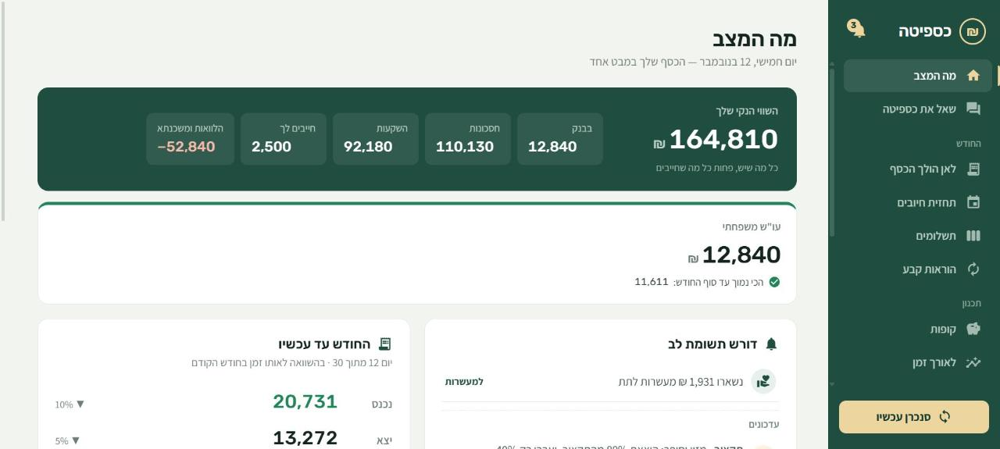
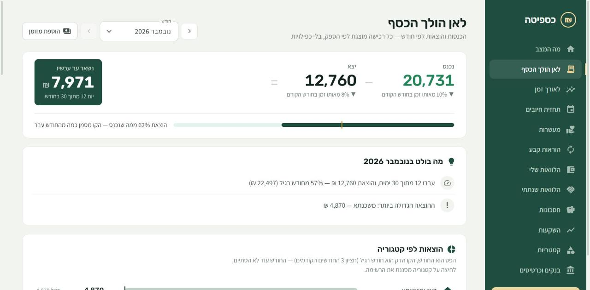
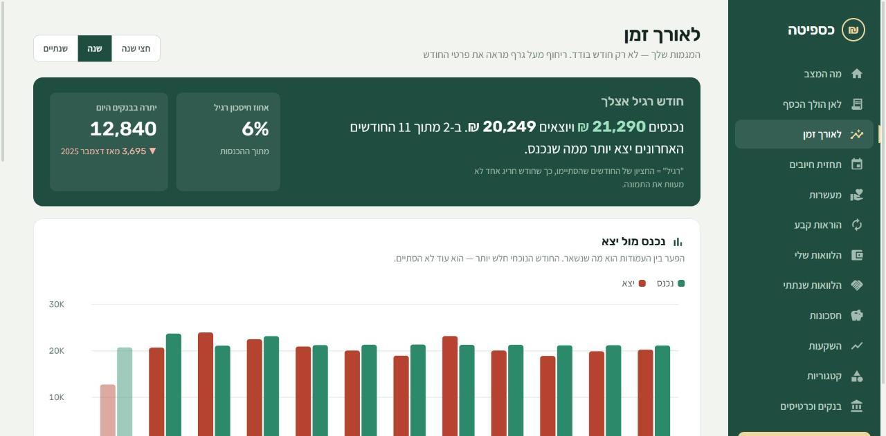
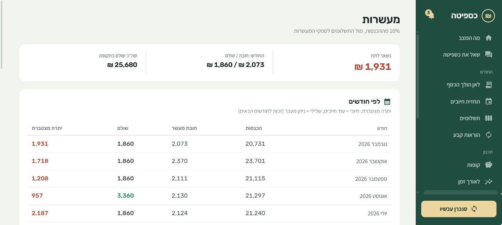
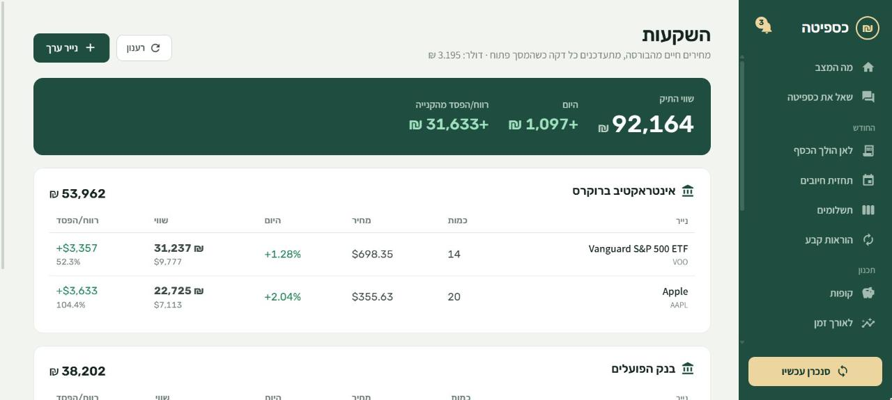
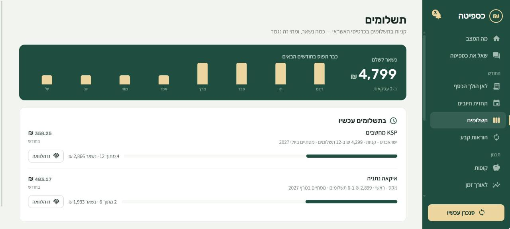
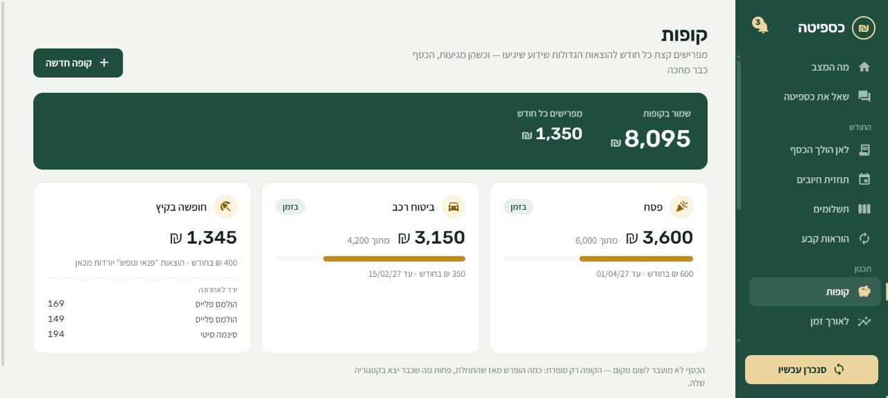
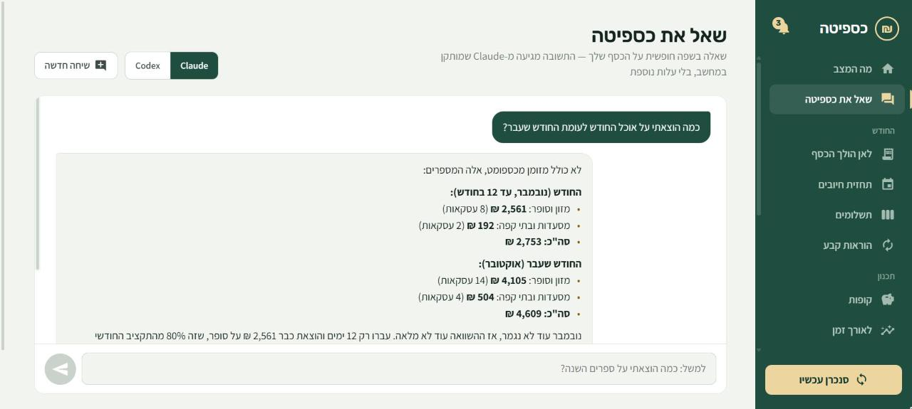
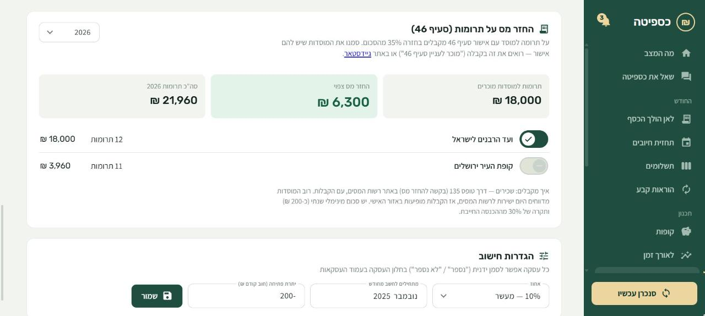

<div dir="rtl">

# כספיטה

דשבורד כספים אישי לחשבונות בנק וכרטיסי אשראי בישראל. המערכת מושכת את התנועות ישירות מאתרי הבנקים וחברות האשראי, שומרת אותן אצלכם במחשב, ומציגה תמונה מלאה של מצב הכסף.



## צילומי מסך

<sub>מתוך מצב ההדגמה — כל הנתונים בדויים</sub>

| לאן הולך הכסף | לאורך זמן |
|---|---|
|  |  |
| **מעשרות** | **השקעות** |
|  |  |
| **תשלומים** | **קופות** |
|  |  |
| **שאל את כספיטה** | **החזר מס על תרומות** |
|  |  |

## מה יש בפנים

- **מה המצב** — יתרות, השווי הנקי, הנקודה הנמוכה הצפויה החודש, ורשימת דברים שדורשים תשומת לב
- **שאל את כספיטה** — שאלות בשפה חופשית על הכסף שלכם ("כמה הוצאתי על ספרים השנה?"), דרך Claude Code או Codex שמותקנים במחשב — בלי מפתח API ובלי עלות נוספת
- **התראות** — חיוב קבוע שהתייקר או התוזל (גם תשלום משכנתא אחרי שינוי ריבית), חריגה מתקציב, תשלומים שהסתיימו, חיוב כפול או גבוה מהרגיל, ספק חדש בכרטיס, עמלה חדשה, והחזר הלוואה שלא הגיע
- **תנועות** — לפי חודש, מקובצות לפי ספק וקטגוריה, עם תקציב לכל קטגוריה ופיצול של קנייה אחת לכמה קטגוריות
- **ארנק מזומן** — משיכות מהכספומט ופירוט על מה הלך הכסף; הוצאות במזומן שנרשמו יורדות מהמשיכה כדי שלא ייספרו פעמיים
- **תשלומים** — כמה נשאר לשלם על קניות בתשלומים וכמה כבר תפוס בחודשים הבאים (ואפשר לסמן עסקה בתשלומים כהלוואה)
- **קופות** — מפרישים כל חודש להוצאות גדולות צפויות (פסח, ביטוח רכב, חופשה) ורואים אם עומדים בקצב
- **לאורך זמן** — הכנסות, הוצאות ויתרה חודש אחרי חודש
- **סיכום שנה** — כל השנה בעמוד אחד להדפסה: קטגוריות, ספקים, מעשרות, החזר מס, עמלות ואירועים
- **תגיות ואירועים** — כמה עלו חתונה, פסח או שיפוץ, על פני כמה קטגוריות וחודשים
- **כללי סיווג** — "אם התיאור מכיל X והסכום מעל Y ← קטגוריה", עם תצוגה מקדימה של מה שהכלל תופס
- **תחזית חיובים** — חיובי האשראי והוראות הקבע הקרובים, ואזהרה לפני מינוס
- **מעשרות** — חישוב אוטומטי של המעשר מההכנסות, מעקב אחרי מה ששולם ומה שנשאר, וחישוב החזר המס על תרומות למוסדות עם אישור סעיף 46 (כולל ייבוא דוח התרומות מרשות המסים ב-PDF)
- **הוראות קבע** — מזוהות אוטומטית מההיסטוריה
- **הלוואות** — הלוואות שנתתם ושלקחתם, עם שיוך ההחזרים מהבנק
- **חסכונות** — פיקדונות גמ"ח, קרנות השתלמות ועוד
- **השקעות** — תיק ניירות ערך עם מחירים חיים

כרטיסי האשראי מקושרים אוטומטית לחשבון הבנק שממנו הם יורדים, כך שהוצאות לא נספרות פעמיים.

## התקנה

צריך Node.js.

```bash
npm install
cd caspita-client && npm install && cd ..
npm run build:client
npm start
```

ואז לפתוח את http://localhost:3000 ולהוסיף בנק או כרטיס אשראי.

**חשוב:** צרו קובץ `.env` עם מפתח הצפנה משלכם, לפני שמוסיפים בנק:

```
SECRET_KEY=מחרוזת-ארוכה-ואקראית-משלכם
```

## מצב הדגמה

רוצים לראות איך זה נראה בלי לחבר בנק? יש נתוני דמה של משפחה בדויה:

```bash
npm run build:client
npm run demo
```

ואז לפתוח את http://localhost:3001. כדי ליצור את נתוני הדמה מחדש: `npm run demo:reset`.

## פרטיות

- הכול נשמר במחשב שלכם בלבד (קובץ SQLite), שום דבר לא נשלח לשרת חיצוני
- פרטי ההתחברות לבנקים מוצפנים (AES-256-GCM) ולא נשלחים לממשק
- השרת מאזין כברירת מחדל רק למחשב המקומי
- "שאל את כספיטה" מקבל רק עותק לקריאה של הנתונים (בלי פרטי התחברות) ולא יכול לשנות כלום

## טכנולוגיה

שרת Express ו-TypeScript, ממשק Angular, מסד נתונים SQLite. המשיכה מהבנקים מבוססת על [israeli-bank-scrapers](https://github.com/eshaham/israeli-bank-scrapers).

</div>
